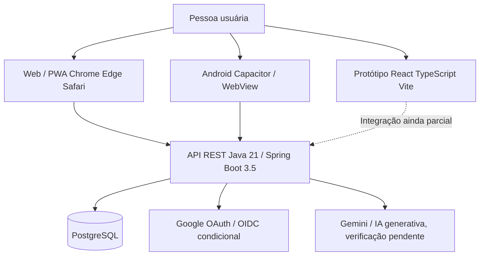

# FLUIR | Dossiê técnico de qualidade e suporte multiplataforma

**Data da auditoria:** 23 de novembro de 2026 (Brasília)
**Repositório:** [Lexissantosz/Fluir-Sistema](https://github.com/Lexissantosz/Fluir-Sistema)
**Branch de trabalho:** `alex/pwa-dispositivos-dossie-23-11`
**Base:** hotfix `alex/hotfix-cors-sessao-23-11`, commit `75e7ca8`
**Responsáveis pela avaliação humana:** Alex (PC) e Dawid (Android); iPhone depende de aparelho disponível.
**Aviso:** documentação técnica de engenharia. **Não é uma declaração de disponibilidade comercial ou homologação de segurança.**

> **Complemento de 23/11:** leia também [QA_COMPLEMENTAR_SESSAO_CICLO_DESKTOP_23-11-2026.md](QA_COMPLEMENTAR_SESSAO_CICLO_DESKTOP_23-11-2026.md). A auditoria adicional realizou 38/38 testes HTTP com três contas fictícias e PostgreSQL isolado, 6/6 verificações de recuperação de sessão, 8/8 testes em Edge e 66/66 JUnit. O deploy em produção continua pendente. Os números abaixo refletem a primeira rodada e são preservados como registro histórico.

## 1. Resumo executivo

O Fluir possui um frontend web principal, backend REST Java/Spring, banco PostgreSQL e protótipos/empacotamentos separados. Nesta auditoria, preparamos metadados e ícones da PWA para instalação no Windows/Android/iOS, registro seguro de Service Worker, página de indisponibilidade offline, ferramentas de avaliação, automação de QA e empacotamento do frontend atual via Capacitor para Android.

**Estados de verificação (não intercambiáveis):**
- **PREPARADO:** código/configuração existe, sem garantia de comportamento em dispositivo.
- **COMPILADO:** a ferramenta de build produziu o artefato; não implica teste de login.
- **TESTADO EM NAVEGADOR:** cenário automatizado aprovado no Chrome, possivelmente com viewport de celular.
- **HOMOLOGADO:** teste físico, isolamento de dados, backend compatível e aceite humano concluídos. **Nenhuma plataforma móvel foi homologada fisicamente hoje.**

## 2. Plataformas e maturidade

| Plataforma | Implementação encontrada/realizada | Evidência objetiva | Próximo bloqueio |
|---|---|---|---|
| Web desktop | HTML, CSS, JS, Vercel; onboarding de 5 etapas, ciclo e planos nas branches de correção | 17/17 testes de planos e 21/21 de ciclo no Chrome | Integração PostgreSQL/staging, QA humano, PR |
| Windows desktop PWA | Manifesto, ícones PNG/SVG, service worker público e inicialização no login | 10/10 testes PWA, 6/6 testes estáticos, teste offline local | Instalação real em Chrome/Edge Windows e teste de atualização |
| Android PWA | Mesma web instalável pelo navegador, com ícones 192/512 | Metadados e viewport Chrome de 390 px | Teste de instalação no aparelho do Dawid |
| Android APK nativo/híbrido | Capacitor 8, appId `br.com.fluir.sistema`, WebView `https://localhost`, tela de login inicial | APK antigo local de 19/11; novo processo de build executado separadamente | Confirmar APK atual, instalar, testar fluxo real e autorização |
| iPhone PWA (Safari) | `apple-touch-icon` 180 px, manifesto em todas as páginas, modo standalone | Metadados presentes e validados em Chrome, NÃO no Safari | iPhone real: Adicionar à Tela de Início, login, ciclo, anexos, teclado |
| iOS nativo (IPA) | **Não implementado** nesta branch; sem projeto Xcode | Ausência da pasta `ios/` e de build iOS | Mac com Xcode, projeto Capacitor iOS, assinatura Apple e testes |
| Protótipo móvel React | React 19, TypeScript, Vite 8 em `mobile/`, telas de demonstração | `npm ci`, `npm run build` e `npm run lint` aprovados | Integração completa com backend e definição de produto; NÃO é React Native |

**Não chamar PWA de aplicativo nativo, não declarar suporte offline aos dados de usuário, não declarar distribuição em Play Store/App Store.** O APK anterior também não contém automaticamente as correções mais recentes de ciclo, planos ou sessão.

## 3. Arquitetura e tecnologias verificadas



**Tecnologias ativas no repositório:** HTML5, CSS3, JavaScript; manifesto PWA, Service Worker, Cache Storage apenas para assets públicos; Java 21; Spring Boot 3.5.0; Spring MVC, Spring Data JPA, Spring Security; BCrypt; OAuth2 JOSE para identificação Google; PostgreSQL; Flyway; Maven; JUnit/Mockito; Vercel; Render; Git/GitHub Actions; Capacitor 8 para Android nesta branch; Node.js 24; React 19/TypeScript/Vite no protótipo independente.

**Tecnologias planejadas ou não comprovadas:** iOS nativo/Xcode, Electron/Tauri, distribuição oficial em lojas, cobrança recorrente, sincronização offline de dados, implantação das migrations V19/V20/V21 em staging, suporte integral ao Gemini em produção. Não declarar React Native como tecnologia implantada.

## 4. Autenticação e sessão: prioridade máxima

A sessão atual utiliza token opaco aleatório com hash SHA-256 persistido no backend; validade observada no código: **12 horas**. O frontend principal guarda `fluir-user` no `sessionStorage`. Portanto, sessão de outra aba, origem ou janela PWA instalada **não é herdada automaticamente**. Uma ausência local de sessão não deve ser apresentada como expiração comprovada.

**Comprovação sem credenciais em 23/11:** `/api/health/live`, `/api/health/ready` e `/api/usuarios/teste` retornaram HTTP 200. Preflight da origem `https://fluir-sistema.vercel.app` retornou 200; prévia Vercel e `127.0.0.1:5505` retornaram 403 por CORS. A branch `alex/hotfix-cors-sessao-23-11` contém correção de CORS restrita às prévias do projeto e loopback; **não foi implantada no Render**.

**Critério de conclusão da sessão:** em staging com contas fictícias A/B, testar login, recarregamento, sessão ausente, expiração real, origem nova permitida, origem maliciosa rejeitada, logout, e autorização entre contas. Exigir HTTP 401 apenas para credencial inválida/expirada; erro de CORS deve ser classificado separadamente. Não desligar autenticação nem criar token persistente como paliativo.

**Próxima ação de infraestrutura com autorização:** confirmar workspace correto no Render, criar/homologar ambiente de staging, revisar variáveis (sem expor valores), aplicar hotfix e testar todas as origens. Não há deploy automático de backend neste relatório.

## 5. Ciclo menstrual, consentimento e planos

- Fluxo de acompanhamento distingue próprio ciclo, uma pessoa ou várias pessoas. A escolha `Meu ciclo e outras pessoas` assume a inclusão do próprio ciclo conforme UX definida; outras opções continuam disponíveis.
- Nome, apelido ou foto **não concedem acesso** ao ciclo de terceiros. Permissões requerem titular autenticado, convite, consentimento granular, revogação e testes de isolamento A/B.
- Fotos de terceiros ficam locais na prévia até autorização; não devem ser armazenadas como prontuário do visitante.
- Primeira vaga de terceiro prevista no gratuito; adicionais são planejadas. Nenhuma cobrança e nenhum desbloqueio pagos foram implantados.
- Planos de referência no onboarding: Gratuito R$ 0, Pessoal R$ 19,90/mês, Completo R$ 39,90/mês. O interesse não é contratação e não concede direitos.
- Migrations `V19`, `V20`, `V21` exigem homologação em PostgreSQL isolado antes de qualquer deploy real.

## 6. PWA, instalação e offline: implementação desta rodada

- Ícones da marca Fluir gerados em **192x192**, **512x512**, **512x512 maskable**, **180x180 Apple**; arquivos nativos Android de 1024 px e splash de 2732 px.
- Manifesto com `id: /`, `scope: /`, `display: standalone` e `start_url: /html/login.html`. Metadados presentes na landing e em todas as páginas de `html/`.
- Script de registro único de Service Worker apenas em origem segura. Capacitor nativo é excluído quando detectado.
- O cache retém **somente recursos públicos**. Não armazena dados de saúde, respostas privadas, contas, tokens ou páginas autenticadas.
- Navegação offline mostra `offline.html`, com instrução para restabelecer conexão. **Login e módulos pessoais não funcionam offline.**
- Corrigida também a ausência de `</head>` em `html/settings.html`.

Referências técnicas: [MDN PWA installability](https://developer.mozilla.org/en-US/docs/Web/Progressive_web_apps/Guides/Making_PWAs_installable), [web.dev manifest](https://web.dev/learn/pwa/web-app-manifest), [Apple/WebKit Home Screen](https://webkit.org/blog/13878/web-push-for-web-apps-on-ios-and-ipados/), [Capacitor 8 requisitos](https://capacitorjs.com/docs/getting-started/environment-setup).

## 7. Evidências executadas nesta rodada

| Conjunto | Resultado | Limitação |
|---|---|---|
| PWA navegador Chrome (registro, cache, offline, login, 390 px) | **10/10** | Não equivale a Safari físico |
| PWA estática e configuração Capacitor | **6/6** | Não equivale a instalação |
| Onboarding, perfil e ciclo (Playwright) | **21/21** | Backend simulado em parte dos cenários |
| Escolhas de planos (Playwright) | **17/17** | Não existe pagamento real |
| Sessões/CORS (JUnit) | **8/8** | CORS da API real ainda 403 até deploy |
| Planos/ciclo (JUnit) | **26/26** (rodada anterior) | Regras e controller aprovados |
| Suíte Java integral | **64/64 aprovados; BUILD SUCCESS** | PostgreSQL 16 isolado via Docker; Flyway validou 21 migrações |
| React/TypeScript/Vite em `mobile/` | **Build e lint aprovados** | Não é o APK Capacitor |
| Saúde do backend, PostgreSQL | **HTTP 200 / HTTP 200** | Readiness não valida login |
| Google OAuth | **Desabilitado** na API pública | Não tentar login social como funcional |
| Gemini | **Não homologado** | Requer teste real controlado com conta fictícia |
| Android debug atualizado | **BUILD SUCCESSFUL; 71 tarefas; APK inspecionado** | Nenhum teste em aparelho físico nesta rodada |
| iPhone físico / instalação Windows PWA | **Não executados** | Dependem dos dispositivos |

Arquivos locais de evidência: `tests/relatorio-pwa-23-11.txt`, `tests/evidencia-pwa-offline.png`, `tests/relatorio-planos-qa.txt`, `tests/relatorio-browser-qa.txt`, `tests/relatorio-api-publica-23-11.txt`, `backend/target/surefire-reports/`.

## 8. Automação e pipeline

Novo workflow `.github/workflows/fluir-multiplataforma-qa.yml` (branch de QA, sem deploy): valida manifesto/ícones, build e lint React, suíte Java e geração de APK Android de debug como artefato temporário. O workflow antigo de vigia do Render continua sendo um **health check**, não um mecanismo de sessão/autenticação.

Comandos reprodutíveis:

```powershell
npm ci
npm run check:pwa
npm run prepare:web
npm run check:web
npm run android:prepare          # Apenas se a pasta android ainda não existir
npm run android:debug:windows    # Requer Android SDK + Java 21 no Windows
npm ci --prefix mobile
npm run lint --prefix mobile
npm run build --prefix mobile
node tests/pwa-dispositivos.e2e.cjs
node tests/onboarding-cycle.e2e.cjs
node tests/onboarding-plans.e2e.cjs
mvn -f backend/pom.xml test
powershell.exe -NoProfile -ExecutionPolicy Bypass -File scripts/qa-api-publica.ps1
```

## 9. Critérios de liberação

**Bloqueadores P0:** autenticação e segregação A/B, sessão + CORS homologados em staging, migrações sem risco, consentimento real e revogável, recursos pagos não indevidamente liberados, nenhuma informação sensível no cache, configuração correta de API e backup.

**Bloqueadores P1:** Android real (instalação, login, navegação e rotação), Safari/iPhone PWA, desktop Windows instalado, regressão após atualização, IA generativa opt-in e falha controlada, acessibilidade por teclado, relatórios de testes e prints.

**P2:** aplicativo iOS nativo (se requerido), instalação oficial de release Android assinada, desktop nativo Electron/Tauri (se necessário), offline sincronizável e cobrança (dependem de arquitetura/contratos próprios).

**Regra de entrega:** tudo em branch de trabalho, sem merge na `main`, sem deploy ou migração em produção sem revisão e aprovação.

## 10. Próxima micro-missão humana

**Alex / PC:** instalar a PWA a partir do site/preview de QA autorizado, confirmar ícone e abertura no login; capturar apenas a tela sem dados pessoais. Depois testar login com conta fictícia no ambiente de staging quando autorizado.

**Dawid / Android:** instalar o APK de debug atualizado (quando compilado e compartilhado com segurança), abrir Fluir, verificar que inicia no login, testar navegação e reportar versão do Android, modelo, print e resultado. Não testar dados de terceiros reais.

**Avaliador iPhone:** Safari → Compartilhar → Adicionar à Tela de Início; abrir pelo ícone, verificar login, teclado, rolagem e ciclo; registrar versão do iOS. Se não houver aparelho, status permanece **NÃO TESTADO**.

**QA automatizado / time:** validar em PostgreSQL isolado, contas A/B, CORS permitido/bloqueado, sessão expirada, IA com opt-in, JUnit/Mockito, Playwright/Cypress, Postman e JMeter antes de homologação.

**Definição de pronto:** arquivo de build + teste funcional + segurança + evidência + aceite humano. Um APK gerado ou um teste de viewport isolado não satisfaz os cinco critérios.
