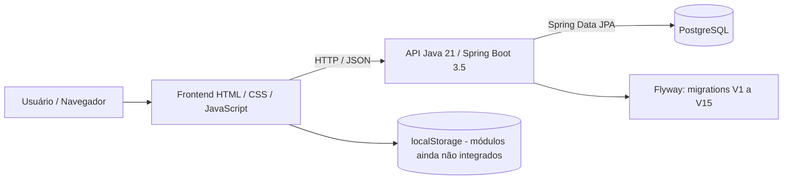

# Fluir | Arquitetura técnica
**Atualização:** 30/10/2026  
**Fonte:** código, `pom.xml`, Docker Compose e configurações revisadas na branch `dawid/realoca-atalhos-calendario-agua-19-10`.

## Visão geral


## Camadas
### Frontend
- Interface web em `html/`, `css/` e `js/`.
- Responsividade em CSS próprio e `css/mobile.css`.
- Navegação compartilhada em `js/sidebar.js`.
- Parte das preferências, conquistas e registros pode depender de armazenamento local do navegador.
- Hospedagem do frontend: Vercel, domínio de apresentação `https://fluir-sistema.vercel.app/`.

### Backend
- Java 21 e Spring Boot 3.5.0 (Maven).
- API REST com Spring Web; validações Jakarta Bean Validation.
- Estrutura de código: `controller/`, `service/`, `repository/`, `model/`, `dto/`, `config/`, `security/`.
- Spring Security, BCrypt e filtro `FluirSessionFilter`; sessões de login persistidas via tabela de hash de token.
- Endpoints identificados: `/api/usuarios/cadastro`, `/api/usuarios/login`, `/api/usuarios/teste`, `/api/onboarding/usuario/{id}`, `/api/tarefas`.
- Há código de onboarding cujo método de salvamento deve ser verificado quanto ao mapeamento HTTP antes de ser anunciado como funcional.

### Banco de dados
- PostgreSQL 16 em `docker-compose.yml`, porta local publicada `5433`.
- Spring Data JPA/Hibernate: `ddl-auto=validate`.
- Flyway: migrations `V1` a `V15`, armazenadas em `backend/src/main/resources/db/migration/`.
- Credenciais de conexão obtidas de variáveis de ambiente; **nunca publicar senha ou token**.

## Responsabilidades e principais fluxos
1. **Login:** frontend chama `POST /api/usuarios/login`; o backend verifica a conta e gera sessão conforme a implementação.
2. **Onboarding:** interface coleta perfil, módulos e preferências; backend possui controlador, serviço e persistência, com pontos a validar.
3. **Tarefas:** o navegador chama a API; `TarefaController` usa repositórios JPA para consultar, criar, atualizar status e excluir.
4. **Água e conquistas:** telas e regras de interface em JavaScript; confirmar quais dados estão em `localStorage` antes de prometer sincronização entre aparelhos.

## Execução local
```bash
# Exige Docker e um arquivo .env local (não versionar segredos).
docker compose up --build
```
No Compose revisado: backend em `localhost:8080`, PostgreSQL exposto em `localhost:5433`; a interface pode ser aberta com Live Server.

## Ambiente publicado
- Frontend: **Vercel**, com deploys de preview nas branches.
- Backend apontado no projeto: **Render**, em `https://fluir-sistema.onrender.com`.
- Hospedagem do banco de produção: **não inferir pelo Compose**; confirmar a instância e o status no painel do provedor.
- Uma implantação `READY` na Vercel não comprova que a API e o banco estejam disponíveis.

## Pontos de qualidade e segurança para revisar
- `SecurityConfig` contém permissões abertas para rotas fora do onboarding; auditar autorização por usuário, especialmente `/api/tarefas`.
- Conferir sessão depois de reinício/redeploy do backend.
- Evitar dados reais na conta de demonstração; não colocar tokens no QR code.
- Versionar scripts de teste e executar regressão antes de fazer merge.
- Integrar branches aprovadas antes de afirmar que estão em produção.

## Deploy e recuperação
Push na branch de feature gera **preview**, não deve ser confundido com produção. Publicar somente código validado e aprovado pela equipe; manter opção de rollback e registrar evidência de testes. O monitoramento proposto em `testes/monitoramento.md` serve para detectar falhas, não para garantir disponibilidade absoluta.
