# Fluir | Banco de dados
**Tecnologia comprovada no repositório:** PostgreSQL 16 + Spring Data JPA + Flyway (migrations V1–V15).  
**Atenção:** descrições antigas podem mencionar MySQL, mas as configurações e migrations examinadas são de **PostgreSQL**.

## Diagrama simplificado

```mermaid
erDiagram
    usuarios ||--o| perfis_usuario : possui
    usuarios ||--o| modulos_usuario : configura
    usuarios ||--o| preferencias_agua : define
    usuarios ||--o{ tarefas : cria
    usuarios ||--o{ habitos : acompanha
    usuarios ||--o{ sessoes_login : autentica
    usuarios ||--o| preferencias_tarefas : personaliza
    usuarios ||--o| preferencias_habitos : personaliza
    usuarios ||--o| preferencias_sono : personaliza
    usuarios ||--o| preferencias_financas : personaliza
    usuarios ||--o| preferencias_diario : personaliza
    usuarios ||--o| preferencias_alimentacao : personaliza
    usuarios ||--o| preferencias_saude_fisica : personaliza
    usuarios ||--o| preferencias_ciclo_menstrual : personaliza
    usuarios ||--o| preferencias_anexos : personaliza
```


## Dicionário das principais tabelas
| Tabela | Papel | Relação |
|---|---|---|
| `usuarios` | Contas (id, nome, email único, senha com hash, criação) | Entidade principal |
| `perfis_usuario` | Perfil, preferências gerais e status do onboarding | 1:1 com usuário |
| `modulos_usuario` | Módulos habilitados | 1:1 com usuário |
| `tarefas` | Tarefas, status, descrição, prioridade, data, horário e categoria | N:1 para usuário |
| `habitos` | Título, frequência, horário, categoria | N:1 para usuário |
| `preferencias_agua` | Meta e preferência de hidratação | 1:1 com usuário |
| `sessoes_login` | Hash do token, criação e expiração | N:1 para usuário |

## Outras tabelas de preferência
`preferencias_tarefas`, `preferencias_habitos`, `preferencias_sono`, `preferencias_financas`, `preferencias_diario`, `preferencias_alimentacao`, `preferencias_saude_fisica`, `preferencias_ciclo_menstrual` e `preferencias_anexos`. Cada uma tem `usuario_id` único e chave estrangeira para `usuarios(id)`, com exclusão em cascata.

## Evolução do esquema (Flyway)
- **V1:** usuários, hábitos, tarefas, perfis, módulos e preferência de água.
- **V2–V4:** campos adicionais de tarefas e perfil.
- **V5–V7:** preferências de tarefas, hábitos e sono.
- **V8:** campos adicionais de preferência de água.
- **V9–V14:** preferências dos módulos de finanças, diário, alimentação, saúde física, ciclo menstrual e anexos.
- **V15:** sessões persistentes com token armazenado como **hash** e índice de expiração.

Arquivos-fonte: `backend/src/main/resources/db/migration/`. A verdade sobre as tabelas criadas é a sequência efetivamente executada no banco; esta documentação representa as migrations do repositório, **não uma inspeção do banco de produção**.

## Integridade e segurança
- Chaves primárias numéricas e estrangeiras com `ON DELETE CASCADE` nas tabelas relacionais indicadas.
- Unicidade de `usuarios.email` e de `usuario_id` nas tabelas 1:1.
- As senhas são representadas por hash na aplicação; nunca armazenar senha em texto legível.
- Usar variáveis `DB_HOST`, `DB_PORT`, `DB_NAME`, `DB_USER` e `DB_PASSWORD` no backend, sem commit de segredos.
- Revisar as permissões da API para garantir que um usuário não acesse tarefas de outro.

## Execução local e verificação
No `docker-compose.yml`, o serviço `db` utiliza a imagem `postgres:16`, banco `fluir`, volume `fluir_db_data` e mapeamento de porta `5433:5432`.

```bash
docker compose up --build
docker compose ps
# Consultar histórico de migrations (se houver credenciais locais adequadas)
docker compose exec db psql -U "$DB_USER" -d fluir -c "SELECT installed_rank, version, description, success FROM flyway_schema_history ORDER BY installed_rank;"
```

> **Nota:** não usar dados pessoais reais para demonstração. A consulta do Flyway acima é um exemplo para um ambiente local configurado, não um resultado de execução.
